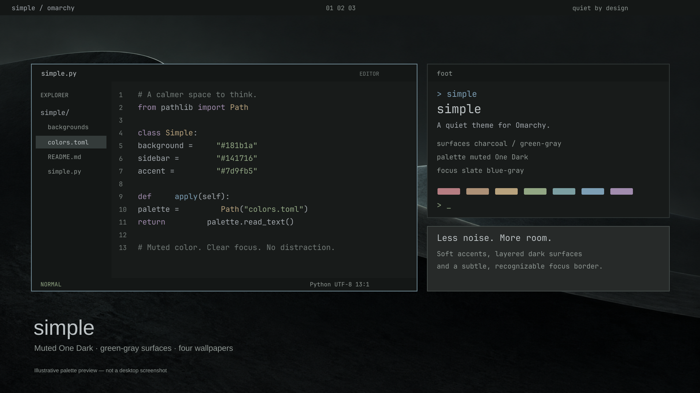

# simple

A quiet dark theme for Omarchy: green-gray surfaces, muted One Dark-inspired colors, and a subtle slate focus border.



The preview is a palette-accurate illustration of an editor and terminal, not a desktop screenshot. Actual app layouts vary.

## Install

After publishing this repository as `omarchy-simple-theme`, replace `YOUR_USERNAME` with your GitHub account:

```sh
omarchy theme install https://github.com/YOUR_USERNAME/omarchy-simple-theme.git
```

Omarchy derives the theme name `simple` from that repository name. The installer replaces an existing theme directory with the same name; back up any personal `simple` customizations first.

For local installation from a clone, copy the theme into the user theme directory, then apply it:

```sh
mkdir -p ~/.config/omarchy/themes/simple
cp colors.toml shell.*.toml vscode-theme.json obsidian.css preview.png ~/.config/omarchy/themes/simple/
cp -r backgrounds ~/.config/omarchy/themes/simple/
omarchy theme set simple
```

Requires an Omarchy version that supports semantic `colors.toml` palettes and `shell.<section>.toml` overlays. Tested on the local Omarchy installation on 2026-10-01. Terminal and Neovim configs are generated by Omarchy; this repository does not ship executable theme configuration.

## Wallpapers

Four original AI-generated wallpapers, each **1672 × 941 px**, with subdued contrast and broad negative space. They are approximately 16:9; no artificial 4K upscaling was applied.

| Wallpaper | Style |
| --- | --- |
| [Quiet forms](backgrounds/01-minimal.png) | Minimal matte sculptural curves |
| [After rain](backgrounds/02-cyberpunk.png) | Restrained cyberpunk city in fog |
| [Graphite mark](backgrounds/03-omarchy.png) | Omarchy pixel wordmark in dark graphite |
| [Still water](backgrounds/04-nature.png) | Misty alpine lake at blue hour |

Cycle them with `omarchy theme bg next`. Keep an existing wallpaper when applying the theme with:

```sh
OMARCHY_THEME_SKIP_BACKGROUND=1 omarchy theme set simple
```

## Palette

| Role | Color |
| --- | --- |
| Main surface | `#181b1a` |
| Sidebar / bar | `#141716` |
| Raised surface | `#272a29` |
| Text | `#a1a7ac` |
| Bright text | `#bdc3c5` |
| Accent | `#7d9fb5` |
| Focus border | `#708994` |
| Inactive border | `#2f3534` |

Backgrounds and shell overlays are independent of terminal font size, monitor scale, input method, window gaps, and opacity settings. Those remain user preferences. Apps with independent themes may not follow the system palette.

## Assets and preview

Wallpapers were generated with the built-in image generation tool. Exact prompts are saved in [docs/image-prompts.json](docs/image-prompts.json). The Omarchy wallpaper used the official wordmark as a visual reference.

The preview uses the actual `colors.toml` values. Regenerate it with Python 3.11+ and `rsvg-convert` (librsvg):

```sh
python3 docs/render-preview.py
```

## Credits and license

Palette inspiration: [One Dark](https://github.com/atom/one-dark-syntax). App theme and shell structures are adapted from [Omarchy](https://github.com/basecamp/omarchy) templates. See [LICENSE](LICENSE) and [NOTICE.md](NOTICE.md). This is an independent community theme.
